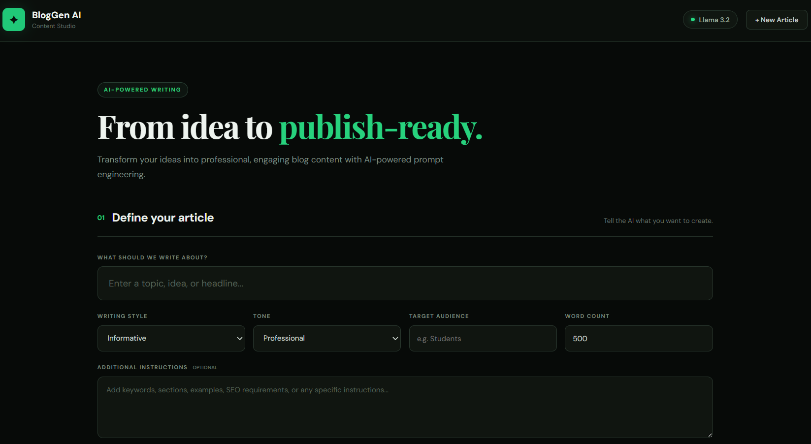
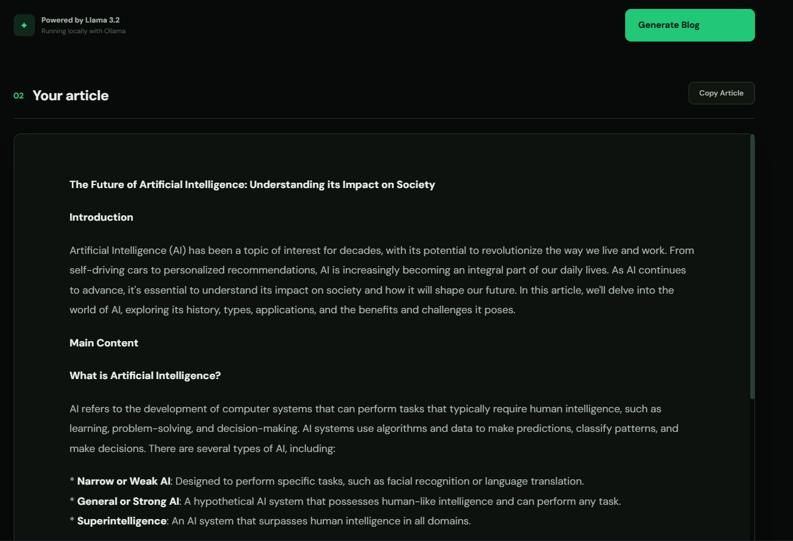

# BlogGen AI

An AI-powered Blog Content Generator built using **Flask, Ollama, and Llama 3.2**.

## Features

- AI-powered blog content generation
- Llama 3.2 with Ollama
- Custom writing style
- Custom tone selection
- Target audience customization
- Adjustable word count
- Additional instructions
- Copy generated article
- Professional dark-themed UI
- Local AI generation

## Technologies Used

- **Python**
- **Flask**
- **HTML5**
- **CSS3**
- **JavaScript**
- **Ollama**
- **Llama 3.2**

## How It Works

1. The user enters a blog topic.
2. The user selects the writing style and tone.
3. The target audience and word count are specified.
4. Additional instructions can be provided.
5. Flask creates an optimized prompt using the given inputs.
6. The prompt is sent to **Llama 3.2 through Ollama**.
7. Llama 3.2 generates the blog content.
8. The generated article is displayed in the web application.
9. The user can copy the generated article.

## Installation & Setup

### 1. Clone the Repository

    git clone https://github.com/VSRohith/BlogGen-AI.git
    cd BlogGen-AI

### 2. Install Python Dependencies

    pip install -r requirements.txt

### 3. Install Ollama

Install Ollama on your system and make sure it is running.

### 4. Download Llama 3.2

    ollama pull llama3.2

Verify the installed model:

    ollama list

You should see:

    llama3.2

### 5. Run the Application

    python app.py

Open the local URL displayed in the terminal.

## Project Structure

    EXp2/
    │
    ├── screenshots/
    │   ├── UI.png
    │   ├── User Prompt.png
    │   └── Output.png
    │
    ├── static/
    │   ├── style.css
    │   └── script.js
    │
    ├── templates/
    │   └── index.html
    │
    ├── .gitignore
    ├── app.py
    ├── requirements.txt
    └── README.md

## Screenshots

### User Interface

  

### User Prompt

  

### Generated Blog Output

  

